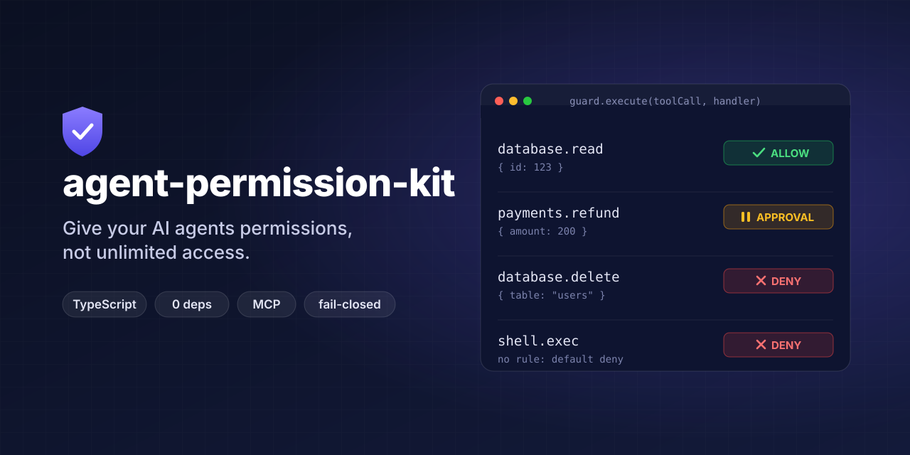
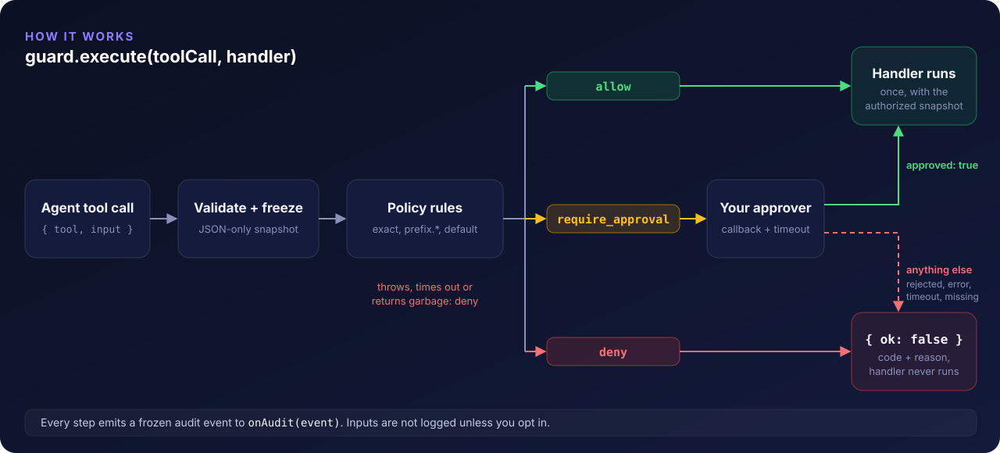

<p align="center">
  
</p>

<p align="center">
  <a href="https://github.com/Truta446/agent-permission-kit/actions/workflows/ci.yml"></a>
  
  
  
  
  <a href="LICENSE"></a>
</p>

<p align="center">
  <a href="#quick-start">Quick start</a> ·
  <a href="#conditional-rules">Conditional rules</a> ·
  <a href="#human-approval">Human approval</a> ·
  <a href="#mcp-integration">MCP</a> ·
  <a href="#security-model">Security model</a> ·
  <a href="#api">API</a>
</p>

---

Allow, deny, or require human approval for every tool call your agent makes, with a small typed API that runs in your process. Unknown tools are denied by default. There is no gateway, no cloud account and no policy language. It has zero runtime dependencies and includes an optional adapter for the official MCP TypeScript SDK.

```ts
import { createGuard } from "agent-permission-kit";

const guard = createGuard({
  rules: {
    "database.read": "allow",
    "database.delete": "deny",
    "payments.refund": "require_approval",
  },
});

const result = await guard.execute(
  { tool: "database.read", input: { id: 123 } },
  async (input) => db.findById(input.id), // runs only if authorized
);
```

## Why

Agents call tools that read databases, send email, move money and delete files, and the model chooses the arguments. Most stacks give an agent either every tool or none. In between you need three things:

- a **deterministic** decision for each call: allow, deny, or ask a human
- that fails **closed** when a policy throws, an approver is unreachable or a value is malformed
- that is **bound to the exact arguments** that run, so they can't change between check and execution

agent-permission-kit is that layer, and nothing more.

## How it works

<p align="center">
  
</p>

## Features

- **Three decisions:** `allow`, `deny`, `require_approval`. Unknown tools are denied.
- **Conditional rules** as typed functions of the tool input and your app context, for example "allow refunds under $50".
- **Human approval** through a callback, with a timeout and abort signal. Only `{ approved: true }` counts.
- **`execute()` wrapper:** the handler runs at most once, only after authorization, with a frozen copy of the authorized input.
- **Audit events**, structured. Inputs are not logged by default; opt-in logging redacts sensitive keys.
- **Replay protection:** a tool-call id that has already been processed is refused.
- **Typed tool maps:** typos in tool names and input fields are compile errors.
- **MCP adapter:** guard every tool on an `McpServer` (SDK v1 or v2) with one call.
- Zero dependencies, ESM + CJS, Node ≥ 22.

## Install

```sh
npm install agent-permission-kit
# or: pnpm add agent-permission-kit
```

## Quick start

```ts
import { createGuard } from "agent-permission-kit";

const guard = createGuard({
  rules: {
    "database.read": "allow",
    "database.delete": "deny",
    "payments.refund": "require_approval",
  },
});

// 1. Ask what policy says. This executes and approves nothing.
await guard.check({ tool: "payments.refund", input: { amount: 200 } });
// { decision: "require_approval", reason: "Human approval required",
//   ruleId: "payments.refund", code: "rule", tool: "payments.refund", requestId: "…" }

// 2. Authorize and run in one step.
const result = await guard.execute({ tool: "database.delete", input: { id: 1 } }, deleteRow);
if (!result.ok) {
  console.log(result.code, result.reason); // "policy_denied" "Denied by policy"
}
```

`require_approval` means a human **must** approve. It never means a human **has** approved. Approval happens only inside `execute()`, through your callback.

## Conditional rules

Declare your tools' input types to get typed conditions and compile-time checks on tool names:

```ts
type Tools = {
  "payments.refund": { amount: number; currency: string };
  "database.delete": { table: string; id: number };
};

const guard = createGuard<Tools, { role: "agent" | "admin" }>({
  rules: {
    "payments.refund": ({ input }) => {
      if (input.amount < 50) return "allow";
      if (input.amount <= 500) return { decision: "require_approval", reason: "Needs a manager" };
      return { decision: "deny", reason: "Refunds above $500 are not allowed" };
    },
    "database.delete": async ({ context }) =>
      context?.role === "admin" ? "require_approval" : "deny",
  },
});

await guard.check({ tool: "payments.refund", input: { amount: 20, currency: "USD" } }); // allow
// @ts-expect-error: typo in tool name
await guard.check({ tool: "payments.refnud", input: { amount: 20, currency: "USD" } });
```

Policy functions are **trusted application code**: they run in your process with full privileges. Never build one from text an agent or a user supplied.

### Wildcards and precedence

```ts
rules: {
  "db.*": "allow",               // any tool starting with "db."
  "db.admin.*": "require_approval",
  "db.admin.drop": "deny",
}
```

1. An exact name always wins.
2. Otherwise the longest matching `prefix.*` wins. The order you declare rules in doesn't matter.
3. Otherwise `defaultDecision` applies: `"deny"` (default) or `"require_approval"`. `"allow"` is not accepted as a default.

Names are case-sensitive, 1–128 characters long, and limited to `A–Z a–z 0–9 _ - . / :`. A bare `*` is rejected; use `defaultDecision` instead.

## Human approval

```ts
const guard = createGuard({
  rules: { "payments.refund": "require_approval" },
  approvalTimeoutMs: 120_000, // default: 5 minutes
  onApprovalRequired: async (request) => {
    // request: { tool, input, context, reason, ruleId, requestId, requestedAt, signal }
    const answer = await slackApproval(request, { signal: request.signal });
    return answer.ok
      ? { approved: true, approvedBy: answer.userId }
      : { approved: false, reason: answer.comment };
  },
});

const result = await guard.execute(
  { tool: "payments.refund", input: { amount: 200, orderId: "A-1" } },
  async (input, { approval }) => refunds.create(input), // approval?.approvedBy is available here
);
```

Approval lifecycle: **required → requested → granted**, or **not granted**. Not granted covers rejected, invalid, error, timeout and aborted. The handler runs only on **granted**. These all count as not granted:

| Situation | `result.code` |
|---|---|
| No `onApprovalRequired` configured | `approval_unavailable` |
| `{ approved: false }` | `approval_rejected` |
| Anything other than an object with an own `approved: true` (`"yes"`, `1`, `{status: "pending"}`, …) | `approval_invalid` |
| Callback throws or rejects | `approval_error` |
| No answer within `approvalTimeoutMs` (a late answer is ignored) | `approval_timeout` |
| Caller's `signal` aborted | `aborted` |

Approvals are single-use: every `execute()` call asks again. **Your application authenticates the approver.** This library records the `approvedBy` you report but can't verify it.

## The `execute()` wrapper

`guard.execute(request, handler)`:

1. Validates the request and copies `input` into a deeply **frozen snapshot**. Only JSON-shaped data is accepted, and each property is read exactly once.
2. Refuses a `requestId` this guard has already seen. Pass your LLM's tool-call id here to block replays.
3. Evaluates policy against the snapshot.
4. Obtains approval if required.
5. Calls `handler(snapshot, ctx)` **at most once**, after re-checking the abort signal.

Refusals resolve to `{ ok: false, code, reason, … }`. A refusal never throws, so you can feed `reason` back to the model. If the handler itself throws, the error is re-thrown unchanged.

> **Use the `input` argument, not variables from the surrounding scope.** The guard authorizes the snapshot it passes to you. If your handler ignores it and acts on something else, the guard can't protect you.

**Security boundary:** the wrapper protects calls that go through it. It does not stop code that calls your tools directly. Keep tool implementations reachable only through `execute()`, or through `guardMcpServer` on an MCP server.

## Audit events

```ts
createGuard({
  rules,
  onAudit: (event) => logger.info(event),
  auditInput: false,   // default; true = include input with sensitive keys redacted; or (input, tool) => custom
  requireAudit: false, // true = if `tool.allowed` / `approval.granted` cannot be recorded, do not execute
});
```

| `type` | When |
|---|---|
| `tool.allowed` | policy allowed the call |
| `tool.denied` | policy denied it, or the request was invalid, duplicate or aborted |
| `approval.requested` | the approval callback is about to be called |
| `approval.granted` / `approval.rejected` | approval outcome (`code` says why it was not granted) |
| `execution.succeeded` / `execution.failed` | handler finished or threw (`errorName` only, never the message) |

Every event carries `timestamp`, `requestId`, `tool`, `decision`, `reason` and `ruleId`. Events are frozen and the handler's return value is ignored, so audit code cannot change a decision. Audit failures go to `onAuditError` (default `console.error`) and are never swallowed silently. `check()` emits no events.

## MCP integration

The official MCP TypeScript SDK has no tool-call middleware, so the adapter wraps tool handlers. It works with `McpServer` from both `@modelcontextprotocol/sdk` (v1) and `@modelcontextprotocol/server` (v2), and doesn't import either.

```ts
import { createGuard } from "agent-permission-kit";
import { guardMcpServer } from "agent-permission-kit/mcp";
import { McpServer } from "@modelcontextprotocol/server"; // or "@modelcontextprotocol/sdk/server/mcp.js"
import * as z from "zod";

const guard = createGuard({
  rules: { "notes.read": "allow", "notes.delete": "deny" },
});

const server = new McpServer({ name: "notes", version: "1.0.0" });
guardMcpServer(server, guard); // call before registering tools

server.registerTool("notes.read", { inputSchema: z.object({ id: z.string() }) }, async ({ id }) => ({
  content: [{ type: "text", text: await notes.get(id) }],
}));
// Every tool registered from now on is guarded under its own name.
// Tools without a rule are denied.
```

Once `guardMcpServer()` has run:

- Each `registerTool` handler runs through `guard.execute()`, after the SDK validates the arguments.
- A refused call returns `{ isError: true, content: [{ type: "text", text: "Tool call … was not executed: <reason>" }] }`, so the model sees why. You can customize this with `onDenied`.
- `registeredTool.update({ callback })` is wrapped too, and `update({ name })` re-binds the policy to the new name. On v1, direct assignment to `registeredTool.handler` is also wrapped.
- The deprecated v1 `server.tool()` is disabled, and non-function (task) handlers are refused.
- `context: (extra) => …` maps the SDK's request context (`authInfo`, `sessionId`) into your policy context.

To wrap tools one at a time instead, use `guardToolHandler(guard, "notes.read", handler)`. A runnable server and client are in [`examples/mcp-server`](examples/mcp-server).

## Security model

**Guaranteed, and covered by tests in [`tests/`](tests):**

1. Unknown tools are denied, and `"allow"` can't be set as the default.
2. A missing, throwing, timed-out, aborted or invalid approval never grants access.
3. A throwing, rejecting, timed-out or malformed policy result denies.
4. The handler gets the frozen snapshot that was evaluated and approved. Changes to the caller's object after the check have no effect.
5. Tool names can't hit inherited properties (`constructor`, `__proto__`). Every security-relevant field is read as an own property, so a polluted `Object.prototype` can't supply `approved: true` or an approval callback.
6. Audit handlers can't change decisions. With `requireAudit`, an unrecorded allow blocks execution.
7. Raw inputs, contexts and error messages are not logged by default.
8. Concurrent calls share no authorization state except the per-guard set of seen request ids.
9. The rule table is copied at creation; mutating it later has no effect.

**Not guaranteed (non-goals):**

- **Not a sandbox.** Allowed handlers run with your process's full privileges.
- **No protection for direct calls** that bypass `execute()` or the MCP adapter.
- **No identity:** you authenticate users and approvers and pass them in `context`.
- **No prompt-injection detection.** Policies see arguments; they don't judge intent.
- **Replay protection is in-memory and per guard.** It covers the last 10 000 caller-supplied ids and resets on restart.
- **Key-based redaction is best-effort.** Secrets in free-text fields are not detected.
- **A running handler is never cancelled.** It only receives the caller's `signal`.

See [SECURITY.md](SECURITY.md) for how to report vulnerabilities, and [docs/architecture.md](docs/architecture.md) for the design rationale.

## API

| Export | Description |
|---|---|
| `createGuard<Tools?, Context?>(options)` | Creates a frozen guard. Throws `GuardConfigError` on invalid config. |
| `guard.check(request)` | Returns `Promise<PolicyResult>`. Evaluates policy only. |
| `guard.execute(request, handler)` | Returns `Promise<ExecuteResult<T>>`. Authorizes, then calls `handler(input, ctx)` at most once. |
| `redactInput(value)` / `REDACTED` | The built-in key redactor, for composing your own `auditInput` function. |
| `guardMcpServer(server, guard, opts?)` | From `agent-permission-kit/mcp`. Guards every tool registered afterwards. |
| `guardToolHandler(guard, name, handler, opts?)` | From `agent-permission-kit/mcp`. Guards one MCP handler. |

**Request:** `{ tool, input?, context?, requestId?, signal? }`

**Options:**

| Option | Default |
|---|---|
| `rules` | required |
| `defaultDecision` | `"deny"` |
| `onApprovalRequired` | none (approval-required calls are refused) |
| `approvalTimeoutMs` | 300 000 |
| `policyTimeoutMs` | 5 000 |
| `onAudit` | none |
| `onAuditError` | `console.error` |
| `requireAudit` | `false` |
| `auditInput` | `false` |
| `generateRequestId` | `crypto.randomUUID` |

**`ExecuteResult<T>`:**

- `{ ok: true, value, decision, ruleId, tool, requestId, approval? }`
- `{ ok: false, code, reason, decision, ruleId, tool, requestId }`, where `code` is one of: `policy_denied`, `invalid_request`, `policy_error`, `duplicate_request`, `approval_unavailable`, `approval_rejected`, `approval_invalid`, `approval_error`, `approval_timeout`, `aborted`, `audit_failed`

## Development

```sh
pnpm install
pnpm test          # vitest, including real MCP SDK v1 + v2 integration tests
pnpm typecheck     # tsc (also enforces the type-level tests)
pnpm lint          # biome
pnpm build         # tsdown → dist/ (ESM + CJS + .d.ts)
pnpm examples      # runs every example against the built package
```

## Contributing

Issues and PRs are welcome. See [CONTRIBUTING.md](CONTRIBUTING.md). Security issues go through [SECURITY.md](SECURITY.md), not public issues.

## Roadmap

Adapters for framework-native approval hooks are planned: Vercel AI SDK `toolApproval`, OpenAI Agents `needsApproval`, Claude Agent SDK `canUseTool`. See [ROADMAP.md](ROADMAP.md).

## License

[MIT](LICENSE)
